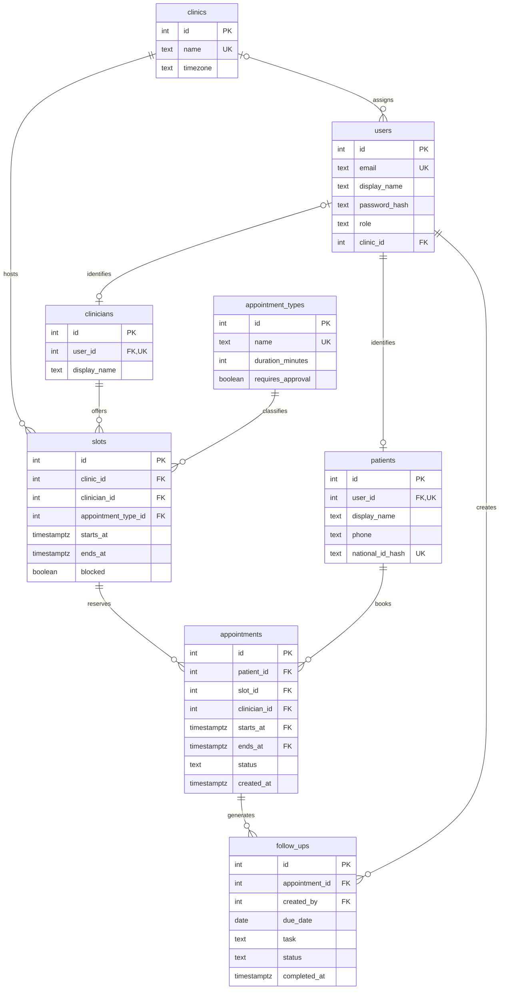

# MediClinicTrack database

An appointment belongs to one patient and reserves a specific clinician's time at a clinic. The slot describes the time the clinic offers. The appointment records who booked it. A clinician can attach several follow-up tasks to that appointment.

## Implemented entity relationships



The four appointment fields `slot_id`, `clinician_id`, `starts_at` and `ends_at` form **one composite foreign key** to the slot. A slot can have several historical appointments after cancellations. The database allows at most one occupying that clinician's time.

## Rules that affect application code

- Store each slot as a start and end instant. Use the clinic's timezone when turning a calendar date into a search interval. The slot end must be later than its start.
- A PostgreSQL exclusion constraint rejects overlapping non-cancelled bookings for the same clinician, including bookings at different clinics. A 09:00–09:30 booking conflicts with 09:15–09:45. A 09:30 start is valid. A competing insert can fail with SQLSTATE `23P01` after an availability search succeeded. Return a conflict and let the patient select again.
- A cancelled booking releases its time. `checked_in`, `completed` and `no_show` retain the time in the appointment history. Clinical policies such as when to mark a no-show belong in the workflow implementing the transition.
- Each account has one role. Receptionists, clinicians and managers require a clinic on their account. Every protected query also checks record ownership or clinic scope on the server. Follow-ups store administrative task text, a due date and an `open` or `done` status. A completed task requires a completion timestamp.
- PostgreSQL stores salted scrypt password hashes and a keyed digest for duplicate national-ID checks. Redis stores temporary sessions. The cookie carries an opaque token, and the Redis key uses its digest. Keep `NATIONAL_ID_SECRET` stable across API and seed runs so duplicate-ID checks continue to work.

## Run and extend the schema

From the backend repository root, with its backend dependencies installed and the local services running, use:

```sh
npm run db:migrate
npm run db:seed
```

`DATABASE_URL` selects the PostgreSQL database. The migration role needs permission to install `btree_gist` or the extension must already exist. Initial classroom seeding reads `DEMO_PASSWORD` (at least 12 characters) and `NATIONAL_ID_SECRET` (at least 32 bytes). The seed creates fictional accounts and two clinics. Rerunning it adds missing example slots for tomorrow and the following day while preserving existing bookings and passwords. The repository setup instructions cover local environment generation. [Backend README](../README.md)

Add new schema changes as numbered SQL files in `database/migrations/`. The runner acquires a transaction lock and records completed filenames in `schema_migrations`. Extend the classroom fixtures for new data and test the upgrade against a populated database as well as an empty one. [Initial migration](../database/migrations/001_clinic_bookings.sql) · [Slot fixtures](../database/seeds/classroom_slots.sql)
