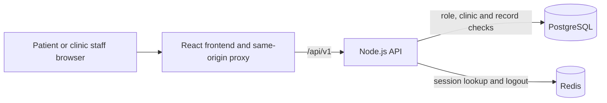

# Run the complete application



## Local container layout

The default Compose services provide PostgreSQL and Redis. The `app` profile adds the backend migration job, API and Nginx frontend. Clone the frontend next to the backend as `meditrack-frontend` or set `FRONTEND_DIR` to its directory in `.env`. From the backend checkout with `.env` created, run:

```sh
docker compose --profile app up --build -d
docker compose --profile app run --rm migrate node dist/migrate.js --seed
```

Open `http://localhost:8080`. PostgreSQL uses a named volume. Redis session keys expire after eight hours and sign-out revokes them immediately. `docker compose --profile app down` stops the local stack. Keep the volume to retain clinic data.

## Shareable demo URL

For a lecturer opening the app from another computer, deploy the frontend and API behind one HTTPS origin. The web server serves the React build and proxies `/api/` to the API. Configure the API with `COOKIE_SECURE=true` and private `DATABASE_URL`, `REDIS_URL` and `NATIONAL_ID_SECRET` values on that host. Run migrations before starting the API. Supply individual demo credentials privately for each invited reviewer. Public hosting, domain ownership and account invitations are separate deployment decisions.

Before sharing the URL, verify sign-in from a second browser, patient-to-reception booking, unauthorised cross-clinic requests, logout and session revocation, and data persistence after an API restart. Configure HTTPS termination, request throttling at the public entry point, database backups and a secret store for the chosen host. Use fictional records for class demonstrations.
